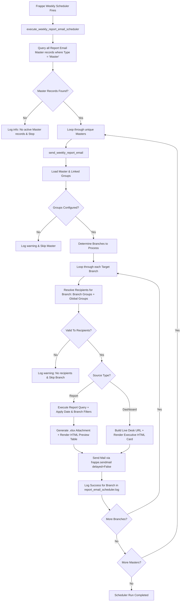

# Email Report Master — Functional & User Documentation
**Steelstrong ERPNext Implementation**
*Unified Scheduled Report and Dashboard Email Distribution System*

---

## Document Control & Summary

| Attribute | Details |
| :--- | :--- |
| **Document Title** | Functional Documentation — Email Report Master |
| **Module / App** | `generate_item` / Core Reporting Extensions |
| **Target Audience** | ERPNext Business Users, Department Leads, System Administrators, Support Teams |
| **Applies To** | Steelstrong ERPNext v15 / v16 |
| **Document Status** | Released & Verified against Codebase |
| **DocType Reference** | `Report Email Master`, `Report Email Group`, `Email Group User`, `Report Email CC` |
| **Scheduler Hook** | `scheduler_events["weekly"]` &rarr; `execute_weekly_report_email_scheduler` |

---

## 1. Introduction and Purpose

### 1.1 What is Email Report Master?
**Email Report Master** is an automated report and dashboard distribution system built into the Steelstrong ERPNext environment. It provides a centralized configuration hub where administrators and functional managers can define:
1. **What business content to distribute:** Any ERPNext standard report, script report, query report, or interactive Desk dashboard/page.
2. **Who should receive the content:** Configurable distribution lists divided into primary recipients (`To`) and secondary stakeholders (`CC`).
3. **How branch-specific data is routed:** Automatic branch data filtering and branch-targeted email dispatch.
4. **How output is delivered:** Automated generation of professional formatted Excel files (`.xlsx`), clean email HTML previews with data summary cards, and executive direct-link dashboard alerts.

### 1.2 Why This Functionality is Used
In standard ERPNext, scheduling report delivery across multiple departments and manufacturing locations often leads to administrative friction:
- Standard "Auto Email Reports" have rigid recipient lists and cannot dynamically segment data by plant or branch.
- Standard email distribution requires recreating duplicate scheduler rules for every single branch.
- Dashboards lack native scheduled email notification workflows with live Desk deep links.
- Recipient management is fragmented; when an employee joins or leaves a team, administrators must hunt down individual scheduled jobs to update addresses.

**Email Report Master** solves these challenges by decoupling the **Content (Master)** from the **Recipients (Group)**:
- Reusable recipient groups can be assigned across multiple report configurations.
- Branch-wise segmentation happens automatically without duplicating report definitions.
- Automatic deduplication guarantees that an executive present in multiple groups receives only **one** clean copy of an email.

### 1.3 Who Uses and Manages It?
- **Configuration Users:** Department Heads, Quality Managers, Production Leads, and ERPNext System Managers who decide which reports must be monitored weekly.
- **Recipients:** Plant Managers, Procurement Teams, Production Supervisors, Quality Control Engineers, and Executive Management.

### 1.4 Real-World Business Scenario
**Steelstrong Manufacturing Operations Example:**
Steelstrong operates multiple manufacturing and administrative branches (e.g., Ahmedabad Plant, Mumbai Office, Surat Works). 
Every Monday morning, plant managers need to review all **"Pending Advanced Material Requests"** specific to their plant. Simultaneously, the General Manager and Managing Director must receive copies of all branch reports to oversee operational bottlenecks.

With **Email Report Master**:
1. A **Group** named `Ahmedabad Plant Operations` is created with local plant engineers as `To` recipients and branch is set to `Ahmedabad`.
2. A **Group** named `Surat Plant Operations` is created with local plant engineers as `To` recipients and branch is set to `Surat`.
3. A **Global Group** named `Executive Oversight` is created with General Managers and Directors as `CC` recipients with **no branch restriction** (global).
4. A **Master** record is created for `Report: Pending Advanced Material Request`, linking all three groups.

**Result on Scheduler Run:**
- The Ahmedabad team receives an email with an Excel attachment filtered strictly for **Ahmedabad** records, with the Executive team on `CC`.
- The Surat team receives an email with an Excel attachment filtered strictly for **Surat** records, with the Executive team on `CC`.
- No plant sees the operational data of another plant, yet the executive leadership receives both branch updates automatically.

---

## 2. Prerequisites & System Setup

Before configuring Email Report Master records, ensure that the following system dependencies are active:

| Category | Prerequisite | Mandatory? | Verification / Where to Check |
| :--- | :--- | :--- | :--- |
| **Permissions** | `System Manager` or `Report Email Manager` role | **Yes** | Navigate to *User > Roles*. User must have at least one of these two roles. |
| **Outgoing Email** | Functional Default Outgoing Email Account | **Yes** | *Settings > Email Account*. Must have `Default Outgoing` checked, valid SMTP credentials, and successful connection test. |
| **System Scheduler** | Frappe Scheduler Active | **Yes** | *Settings > System Settings* &rarr; Check that **Disable Scheduled Tasks** is unchecked. Verify bench worker queue is running. |
| **Source Report/Page** | Target Report or Page exists | **Yes** | *Explore > Report List* or *Page List*. The report must run without syntax errors in ERPNext Desk. |
| **Active Users** | Users must be Enabled with valid email | **Yes** | *User List*. Recipient users must have `Enabled = 1` and a non-empty, valid `Email` address. |
| **Branch Records** | Active Branch records (if branch routing used) | **Conditional** | *Settings > Branch*. Ensure branch names match company plants/offices. |
| **Company Default** | Global Default Company | **Optional** | *Settings > Global Defaults*. Used automatically if a report requires a default company. |

---

## 3. Architecture: Master vs. Group Types

`Report Email Master` uses an intelligent single-DocType dual-mode architecture:

```
                      +-----------------------------+
                      |     Report Email Master     |
                      |        (Type: Group)        |
                      +-----------------------------+
                      | - group_name: "Surat QC"    |
                      | - branch: "Surat"           |
                      | - receipts (To): user1, user2|
                      | - cc: manager1              |
                      +--------------+--------------+
                                     |
                                     | Referenced inside child table
                                     v
+------------------------------------+------------------------------------+
|                      Report Email Master                                 |
|                         (Type: Master)                                  |
+-------------------------------------------------------------------------+
| - Source: Report (or Dashboard)                                         |
| - Report Name: "Pending Advanced Material Request"                       |
| - Document Name: "Report-Pending Advanced Material Request"              |
|                                                                         |
| Child Table: Email Group (`tabReport Email Group`)                      |
| [ Row 1 ]: Group Name = "Surat QC"      | Count = 3 (auto-computed)     |
| [ Row 2 ]: Group Name = "Executive Dir" | Count = 2 (auto-computed)     |
+------------------------------------+------------------------------------+
```

### 3.1 Group Record (`Type = Group`)
- **Purpose:** Represents a reusable email distribution list.
- **Scope:** Can be branch-specific (tied to a single `Branch`) or global (no branch selected).
- **Membership:**
  - `Receipts` child table: Users who will receive the email as **primary (`To`)** recipients.
  - `CC` child table: Users who will receive the email as **courtesy copy (`CC`)** recipients.
- **Naming Rule:** The document `name` is automatically assigned directly from the `group_name` field (e.g., `Mechanical Engineering Group`).

### 3.2 Master Record (`Type = Master`)
- **Purpose:** Represents the scheduled delivery specification for a specific Report or Dashboard.
- **Scope:** Points to a single ERPNext Report or Desk Dashboard and links one or more `Group` records.
- **Naming Rule:** The document `name` is automatically generated by concatenating `{Source}-{Target Name}` (e.g., `Report-Item Shortage Summary` or `Dashboard-production-dashboard`).

### 3.3 What the `Count` Field Represents
Inside a Master record's `Email Group` child table, every row displays a read-only integer field called **Count**:
- **Definition:** The total number of unique recipients (`To` + `CC`) currently resolved by that group.
- **How it is populated:** When a user selects a `Group Name` in the table, an automatic client-side script triggers `get_group_recipient_count`. The system inspects the target group, filters out disabled users, resolves To/CC entries, and instantly updates the row's `Count`.
- **Purpose:** Provides immediate visual feedback to the administrator so they know exactly how many people will be reached without needing to open the group document.

### 3.4 Recipient Deduplication Rules
To prevent email fatigue and embarrassment:
1. **`To` Deduplication:** If a user appears in multiple linked groups, their email is included only **once** in the `To` list.
2. **`CC` Deduplication & Override:** If a user is present in the `CC` list of one group but also in the `To` list of another group, the system prioritizes `To` and **removes them from `CC`**. A user will never receive two copies of the same email.
3. **Inactive User Suppression:** Any user with `enabled == 0` or a blank email address is automatically bypassed during recipient resolution.

---

## 4. Comprehensive Field-by-Field Reference

### 4.1 Master Record Fields (`Type = Master`)

| Section | Field Label | Field Name | Type | Mandatory? | Description & Business Rules |
| :--- | :--- | :--- | :--- | :--- | :--- |
| **Main** | **Type** | `type` | Select | **Yes** | Select **`Master`**. Defaults to `Master`. Determines that this record controls report/dashboard delivery. |
| **Source Details** | **Source** | `source` | Select | **Yes** | Choose **`Report`** (for Excel attachment & data preview) or **`Dashboard`** (for executive link alert). |
| **Source Details** | **Report Name** | `report_name` | Link (`Report`) | **Conditional** | **Mandatory if Source is Report.** Select the ERPNext Report to execute. Hidden when Source is Dashboard. |
| **Source Details** | **Dashboard Name** | `page_name` | Link (`Page`) | **Conditional** | **Mandatory if Source is Dashboard.** Select the Desk Page / Dashboard slug. Hidden when Source is Report. |
| **Email Groups** | **Email Group** | `email_group` | Table | **Yes** | Child table holding the recipient groups. **At least one group row is mandatory.** |

#### Fields in `Report Email Group` Child Table (inside Master):

| Field Label | Field Name | Type | Mandatory? | Description & Business Rules |
| :--- | :--- | :--- | :--- | :--- |
| **Group Name** | `group_name` | Link (`Report Email Master`) | **Yes** | Select an existing Group record. Filtered automatically to show only records where `Type = Group`. |
| **Count** | `count` | Int | Read-only | Automatically calculated number of active recipients in the selected group. |

---

### 4.2 Group Record Fields (`Type = Group`)

| Section | Field Label | Field Name | Type | Mandatory? | Description & Business Rules |
| :--- | :--- | :--- | :--- | :--- | :--- |
| **Main** | **Type** | `type` | Select | **Yes** | Select **`Group`**. Switches form view to Group Configuration mode. |
| **Group Configuration**| **Group Name** | `group_name` | Data | **Yes** | Unique business title for this distribution list (e.g., `Plant Managers - West Zone`). Becomes document ID. |
| **Group Configuration**| **Branch** | `branch` | Link (`Branch`) | **Optional** | If selected, this group only receives emails during that branch's execution. If left blank, group is **Global**. |
| **Recipients** | **Receipts** | `receipts` | Table | **Yes** | Child table holding primary `To` recipients. **At least one user row is mandatory.** |
| **Recipients** | **CC** | `cc` | Table | **Optional** | Child table holding secondary `CC` recipients. |

#### Fields in `Email Group User` Child Table (`receipts`):

| Field Label | Field Name | Type | Mandatory? | Description & Business Rules |
| :--- | :--- | :--- | :--- | :--- |
| **User** | `user` | Link (`User`) | **Yes** | Select the ERPNext user. Filtered automatically to show only active (`enabled = 1`) users. |

#### Fields in `Report Email CC` Child Table (`cc`):

| Field Label | Field Name | Type | Mandatory? | Description & Business Rules |
| :--- | :--- | :--- | :--- | :--- |
| **CC User** | `cc_user` | Link (`User`) | **Yes** | Select the ERPNext user to receive courtesy copies. Filtered to active (`enabled = 1`) users. |

---

## 5. Step-by-Step Configuration Guide

Follow this numbered procedure to set up a complete automated report distribution workflow.

### Step 1: Create Recipient Groups First
*Always create your Group records before creating the Master, so the groups are ready to be linked.*

1. In the ERPNext Search Bar (Awesome Bar), type **`Report Email Master List`** and press Enter.
2. Click the blue **Add Report Email Master** button (or click **+**).
3. In the **Type** field, select **`Group`**.
4. In the **Group Name** field, enter a clear descriptive name (e.g., `Ahmedabad Production Supervisors`).
5. In the **Branch** field:
   - Select a specific branch (e.g., `Ahmedabad`) if this team should only receive Ahmedabad data.
   - Leave it **blank** if this group represents corporate or head-office staff who should receive all branch reports.
6. Scroll down to the **Receipts** table:
   - Click **Add Row**.
   - Select the target **User** from the dropdown. Repeat for all primary recipients.
7. *(Optional)* Scroll to the **CC** table:
   - Click **Add Row**.
   - Select the target **CC User**. Repeat for all courtesy recipients.
8. Click **Save**. The document will be saved with the ID matching your Group Name.

---

### Step 2: Create the Master Distribution Configuration
1. Navigate back to **Report Email Master List** and click **Add Report Email Master**.
2. Keep the **Type** set to **`Master`** (default).
3. In the **Source** field, choose your content type:
   - Select **`Report`** if you are sending tabular data with an Excel spreadsheet.
   - Select **`Dashboard`** if you are sending an executive alert with a live dashboard button.
4. Fill the corresponding target field:
   - If Source is **Report**: Click **Report Name** and select the report (e.g., `Pending Advanced Material Request`).
   - If Source is **Dashboard**: Click **Dashboard Name** and select the page/dashboard (e.g., `production-dashboard`).
5. In the **Email Groups** table:
   - Click **Add Row**.
   - Click the **Group Name** column and choose the Group you created in Step 1.
   - Notice that the **Count** field immediately updates with the total recipient count.
   - Add additional groups as required (e.g., add branch groups plus corporate groups).
6. Click **Save**.
7. The system automatically validates your selections and names the document as `{Source}-{Target Name}` (e.g., `Report-Pending Advanced Material Request`).

---

## 6. Report and Dashboard Content Comparison

| Capability | Source = Report | Source = Dashboard |
| :--- | :--- | :--- |
| **Target Field** | `Report Name` (Link to ERPNext Report) | `Dashboard Name` (Link to Desk Page) |
| **Output Attachment** | Formatted Microsoft Excel spreadsheet (`.xlsx`) | None (No file attached) |
| **Email Body Content** | Summary Card (Record count, Branch, Date) + Styled Preview Table (first 15 rows) | Modern Card with title, branch tag, and clickable "View Live Dashboard" button |
| **Date Range Handling**| Automatically defaults to standard 1-month range (`from_date` = 1 month ago, `to_date` = today) | Live view (date range determined by user's dashboard view in Desk) |
| **Branch Filtering** | Report query filtered by `branch = <Current Branch>` if report supports branch | Appends `?branch=<Current Branch>` parameter to the Desk URL |
| **Subject Line Pattern**| `Weekly Report: {Report Name} - {Branch} - {Date}` | `Weekly Dashboard: {Dashboard Title} - {Branch} - {Date}` |

---

## 7. End-to-End Processing & Scheduler Lifecycle

The automated distribution engine executes autonomously in the background without requiring user intervention.



### Detailed Sequence of Events:
1. **Trigger:** The Frappe task scheduler fires the `weekly` event (hooked to `generate_item.utils.report_email_scheduler.execute_weekly_report_email_scheduler`).
2. **Identification:** The scheduler queries all documents in `Report Email Master` where `Type == "Master"`.
3. **Target Deduplication:** The engine checks for duplicate source-target pairs to ensure no report is processed twice during a single run.
4. **Group & Branch Discovery:** For each Master, the linked groups are inspected:
   - If any linked group has a `branch` specified, the scheduler identifies all unique branches configured across the groups.
   - If no groups specify a branch, the job runs once globally (`branch = None`).
5. **Report Branch Support Check:**
   - The engine checks whether the report supports branch filtering by analyzing its filter definition, underlying DocType fields, and SQL query.
   - **Performance Optimization:** If the report does *not* support branch filtering, data generation executes **once** and the cached result is reused across all branch email drafts.
6. **Branch-Wise Loop:**
   - The engine loops through each target branch.
   - It filters the recipient groups: matching the specific branch plus any global groups (blank branch).
   - Resolves all users into `To` and `CC`, stripping disabled accounts and duplicate emails.
7. **Content Assembly:**
   - **For Reports:** Computes row counts, builds the `.xlsx` file using `xlsxutils.make_xlsx`, and formats an HTML email with the first 15 preview rows.
   - **For Dashboards:** Resolves the human-readable dashboard title and constructs the direct Desk URL.
8. **Delivery:**
   - Dispatches the email via `frappe.sendmail()` with `delayed = False`.
   - Records reference metadata linking the email directly to the `Report Email Master` document for traceability.
9. **Error Isolation:**
   - Each branch and each Master record runs inside an isolated `try-except` boundary. If an error occurs in generating an attachment for Branch A, it is logged to Frappe's **Error Log**, and the scheduler immediately proceeds to process Branch B.

---

## 8. Scheduler: Exact Timing, Triggers, and Verification

### 8.1 Schedule Registration
The scheduler hook is registered in the Steelstrong `generate_item` application under `hooks.py`:
```python
scheduler_events = {
    "weekly": [
        "generate_item.utils.report_email_scheduler.execute_weekly_report_email_scheduler"
    ]
}
```

### 8.2 When Are Emails Sent?
- **Frequency:** **Weekly**.
- **Execution Day & Time:** Frappe Framework's standard weekly scheduler fires once a week (by default, every **Sunday at midnight 00:00:00** system time, or according to your server's configured bench weekly cron).
- **Immediate vs. Queued:** The function calls `frappe.sendmail(..., delayed=False)`. This instructs the system to hand off the message directly to the outgoing SMTP mailer immediately upon generation, rather than waiting for the standard background `frappe.email.queue.flush` batch job.

### 8.3 How to Verify Scheduler Status in Desk
1. Open **Scheduled Job Type List** from the Awesome Bar.
2. Search for the job associated with `execute_weekly_report_email_scheduler` or `weekly`.
3. Check the **Last Execution** timestamp and ensure **Stopped** is set to `0` (False).
4. Review **Error Log List** for any errors under the title `Weekly Report Email Scheduler Fatal Error` or `Weekly Email Failed`.
5. Review **Email Queue List** to verify outgoing email dispatch history.

---

## 9. Branch-Wise Data & Recipient Routing Matrix

The table below illustrates how different group branch settings determine email distribution:

| Configured Group | Group Branch Setting | Recipient in Group | When Processing Branch = "Ahmedabad" | When Processing Branch = "Surat" |
| :--- | :--- | :--- | :--- | :--- |
| **Ahmedabad Team** | `Ahmedabad` | `rahul@steelstrong.com` | **Receives Email** (Ahmedabad data) | *Skipped* |
| **Surat Team** | `Surat` | `priya@steelstrong.com` | *Skipped* | **Receives Email** (Surat data) |
| **Corporate HQ** | *(Blank / None)* | `md@steelstrong.com` | **Receives Email** (Ahmedabad copy) | **Receives Email** (Surat copy) |

---

## 10. Practical Real-World Configuration Examples

### Example 1: Weekly Branch-Wise Production Shortage Report
- **Business Need:** Send the "Material Shortage Summary" every week to plant engineers in Ahmedabad and Surat, with plant managers on CC.
- **Setup:**
  1. Create Group `Ahmedabad Shortage Team`:
     - Branch: `Ahmedabad`
     - Receipts: `ahmedabad_eng1@steelstrong.com`, `ahmedabad_eng2@steelstrong.com`
     - CC: `ahmedabad_mgr@steelstrong.com`
  2. Create Group `Surat Shortage Team`:
     - Branch: `Surat`
     - Receipts: `surat_eng1@steelstrong.com`
     - CC: `surat_mgr@steelstrong.com`
  3. Create Master `Report-Material Shortage Summary`:
     - Source: `Report`
     - Report Name: `Material Shortage Summary`
     - Email Groups: Link both `Ahmedabad Shortage Team` and `Surat Shortage Team`.
- **Outcome:** The scheduler executes branch-wise. Ahmedabad engineers receive Ahmedabad shortage data; Surat receives Surat shortage data. Managers receive CC for their respective plants only.

---

### Example 2: Plant Report with Corporate Executive CC
- **Business Need:** Send the weekly "Pending Advanced Material Request" report to Ahmedabad plant staff, while keeping Corporate Executive leadership informed on CC.
- **Setup:**
  1. Group 1: `Ahmedabad Plant Ops` (Branch: `Ahmedabad`, Receipts: plant supervisors).
  2. Group 2: `Executive Directors` (Branch: *Blank*, CC: `director@steelstrong.com`, `coo@steelstrong.com`).
  3. Master `Report-Pending Advanced Material Request`: Link both groups.
- **Outcome:** Directors are included in the CC field of the Ahmedabad report. If other plant groups are added later, directors automatically receive copies of those plant reports as well.

---

### Example 3: Executive Live Dashboard Link
- **Business Need:** Notify senior management every week to inspect the live interactive "Sales and Production Dashboard" in ERPNext Desk.
- **Setup:**
  1. Group: `Senior Leadership Group` (Branch: *Blank*, Receipts: Senior Management team).
  2. Master `Dashboard-production-dashboard`:
     - Source: `Dashboard`
     - Dashboard Name: `production-dashboard`
     - Email Groups: Link `Senior Leadership Group`.
- **Outcome:** Senior leaders receive an executive HTML notification featuring a styled KPI card and a direct button reading **"View Live Dashboard"** that links directly to their ERPNext Desk session.

---

## 11. Testing & Verification Checklist

To verify a newly configured Email Report Master without waiting for the weekly scheduler:

### 11.1 Verification Matrix

| Check Item | How to Verify in Desk UI | Expected Result |
| :--- | :--- | :--- |
| **Group Document Validity** | Open Group in `Report Email Master` | `Type` is Group. Receipts table has at least one active user. |
| **Recipient Count Verification**| Open Master in `Report Email Master` | `Count` column in `Email Group` table reflects correct positive number. |
| **Report Validity** | Open target Report from Desk | Report runs cleanly with no SQL errors or permission warnings. |
| **Outgoing Mail Setup** | Open *Settings > Email Account* | Default Outgoing account is active with verified credentials. |
| **Execution Verification** | Check *Email Queue List* after run | Emails appear with Subject `Weekly Report: ...` and Status `Sent`. |
| **Attachment Verification** | Open sent email in Email Queue or recipient inbox | `.xlsx` attachment is present, non-corrupted, and contains valid row data. |

---

## 12. Troubleshooting Guide

| Problem / Symptom | Probable Cause | How to Verify | Corrective Action | Responsible Role |
| :--- | :--- | :--- | :--- | :--- |
| **No email received by any user** | Scheduler is disabled in System Settings. | Check *System Settings > Disable Scheduled Tasks*. | Uncheck "Disable Scheduled Tasks". | System Manager |
| **No email received** | Master has no Email Groups linked. | Open Master record in Desk. | Add at least one valid Group row in `Email Group` table and save. | Report Email Manager |
| **Specific user did not receive email** | User account is disabled (`enabled = 0`). | Check user status in *User List*. | Enable user account or replace with an active user in the Group. | System Manager |
| **Specific user did not receive email** | User has no email address configured in User master. | Check `Email` field in *User* DocType. | Enter valid corporate email address in User record. | System Manager |
| **Branch report contains no data** | Report does not support branch filter or branch name misspelled. | Run report manually in Desk and apply branch filter. | Ensure target DocType has a `branch` field or update report SQL. | Technical / ERP Team |
| **Group cannot be selected in Master** | Selected document is of type `Master`, not `Group`. | Check list view filter `Type = Group`. | Create or select a document whose `Type` is set to `Group`. | Report Email Manager |
| **Save Error: "At least one recipient required"** | Receipts table in Group document is empty. | Open Group record. | Add at least one valid user row in `Receipts` child table. | Report Email Manager |
| **Save Error: "Duplicate user in Receipts"** | Same user added more than once in table. | Check `Receipts` table for repeated rows. | Remove duplicate user row before saving. | Report Email Manager |
| **Email fails to send / SMTP error** | Outgoing Email Account credentials expired or blocked. | Check *Error Log List* for SMTP connection timeout. | Update password and test connection in *Email Account*. | System Manager |
| **User received To, but CC was omitted** | User was present in both To and CC lists. | Check deduplication rules in Section 3.4. | Normal system behavior: system promotes user to To and removes from CC. | Informational |

---

## 13. Permissions and Roles Matrix

| Action / Capability | Normal User | Report Email Manager | System Manager |
| :--- | :---: | :---: | :---: |
| Receive scheduled report emails | **Yes** | **Yes** | **Yes** |
| View `Report Email Master` records | No | **Yes** | **Yes** |
| Create & edit Recipient Groups | No | **Yes** | **Yes** |
| Create & edit Report Master schedules | No | **Yes** | **Yes** |
| Delete configurations | No | **Yes** | **Yes** |
| Configure SMTP Email Accounts | No | No | **Yes** |
| Enable / Disable System Scheduler | No | No | **Yes** |
| View Background Scheduler Logs & Errors | No | No | **Yes** |

---

## 14. Important Business Rules & Limitations

1. **Self-Reference Protection:** A Master document cannot reference itself as an email group.
2. **Type Segregation:** A Master record only allows selecting Group records in its `Email Group` table. If a user attempts to select a Master record as a group, validation raises an immediate error.
3. **Circular Reference Prevention:** Group resolution prevents infinite loops. If group references are chained, the recursive resolver tracks visited groups and halts cycles cleanly.
4. **Child Table Cleanup on Deletion:** When a Group is deleted, the system automatically purges references to prevent orphaned child rows in `tabReport Email Group`.
5. **No Immediate Email on Save:** Saving a Master or Group record saves configuration **only**. It does **not** trigger an immediate test email. Emails are triggered exclusively by the weekly scheduler or an administrative script call.
6. **Date Range Defaulting:** Reports requiring `from_date` and `to_date` are automatically defaulted to a 30-day window (`today - 1 month` to `today`), matching the default behavior of ERPNext Desk reports.

---

## 15. Frequently Asked Questions (FAQ)

#### Q1: Does saving an Email Report Master record send an email immediately?
**No.** Saving a record only registers the configuration in the database. Emails are generated and sent automatically when the weekly scheduler runs (or when manually triggered by an administrator).

#### Q2: How often are emails sent?
Emails are dispatched **once a week** under Frappe's `weekly` scheduler interval (typically on Sunday at midnight / early Monday morning).

#### Q3: Will every branch receive the same email?
**No.** If you configure branch-specific groups (e.g., Ahmedabad Group with branch set to Ahmedabad), the engine runs branch-wise. The report is filtered specifically for Ahmedabad, and only Ahmedabad recipients receive that plant's report.

#### Q4: What if an employee is in both the Plant Group and Corporate Group?
The system's deduplication engine combines the recipient lists, ensures the user's address appears only **once** in the `To` field, and removes any duplicate instance from the `CC` field.

#### Q5: Can I attach a Dashboard as an Excel file?
**No.** Dashboards are dynamic visual pages consisting of charts, numbers, and interactive widgets. The system delivers Dashboards as high-impact executive HTML emails with a secure direct button linking to the live dashboard in ERPNext Desk.

#### Q6: What happens if a report produces 0 rows for a branch?
The report is still generated. The email body clearly informs the team with the message: *"No records found for this period"*, and an empty-structure Excel file is attached for audit consistency.

---

## 16. Glossary of Terms

- **Email Report Master:** The core Frappe DocType in the `generate_item` app that manages both distribution rules (`Master`) and recipient groups (`Group`).
- **Master:** A configuration record representing a specific Report or Dashboard scheduled for distribution.
- **Group:** A configuration record representing a named distribution list of users and their branch association.
- **Receipts:** The child table within a Group record that holds primary `To` recipients.
- **CC (Courtesy Copy):** The child table within a Group record that holds secondary `CC` recipients.
- **Count:** An auto-computed integer in the Master table indicating how many unique active recipients belong to a linked Group.
- **Branch-Wise Processing:** The automated capability of running a single report multiple times, each time filtered for a different branch and sent to that branch's team.
- **Delayed = False:** A Frappe email dispatch setting ensuring the email is submitted directly to the mail server without waiting in an outgoing queue.
- **Deduplication:** The automated removal of duplicate email addresses across multiple groups and between To and CC fields.

---

## 17. Final Pre-Flight User Checklist

Before expecting automated weekly emails, verify the following 7 items:

- [ ] **Prerequisites Confirmed:** Default Outgoing Email Account is tested and working in ERPNext.
- [ ] **Scheduler Active:** Scheduled Tasks are enabled in *System Settings*.
- [ ] **Group Created & Saved:** Recipient Group exists with `Type = Group` and contains at least 1 enabled user in `Receipts`.
- [ ] **Branch Assignment Verified:** Group `Branch` field is set correctly (or left blank for global corporate distribution).
- [ ] **Master Created & Saved:** Master record exists with `Type = Master` and has valid `Source` and `Report Name` / `Dashboard Name`.
- [ ] **Groups Linked to Master:** At least one Group is added to the Master's `Email Group` table, and the `Count` column shows a number greater than 0.
- [ ] **Report Runs Cleanly:** The selected Report executes without errors when tested manually in ERPNext Desk.
